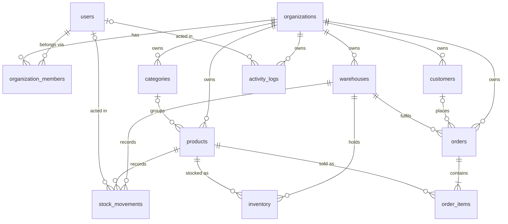

# Database design

PostgreSQL schema for the multi-tenant business operations platform, managed with Prisma 7.

| Item              | Location                                                                                                       |
| ----------------- | -------------------------------------------------------------------------------------------------------------- |
| Schema            | [`apps/api/prisma/schema.prisma`](../apps/api/prisma/schema.prisma)                                            |
| Migrations        | [`apps/api/prisma/migrations/`](../apps/api/prisma/migrations/) (the first one adds CHECK constraints by hand) |
| Seed              | [`apps/api/prisma/seed.ts`](../apps/api/prisma/seed.ts)                                                        |
| Integration tests | [`apps/api/test/database/`](../apps/api/test/database/)                                                        |

## Conventions

| Topic        | Convention                                                                                                                                                                                                                                                                                                                              |
| ------------ | --------------------------------------------------------------------------------------------------------------------------------------------------------------------------------------------------------------------------------------------------------------------------------------------------------------------------------------- |
| Naming       | Prisma models are PascalCase and fields camelCase. PostgreSQL tables and columns are snake_case (`@@map` / `@map`), and table names are plural (`order_items`).                                                                                                                                                                         |
| Primary keys | `uuid` generated by Prisma Client as **UUIDv7**. Time-ordered IDs keep B-tree inserts local, and IDs don't leak row counts.                                                                                                                                                                                                             |
| Timestamps   | `created_at` / `updated_at` as `timestamptz(3)`, both defaulting to `now()`. Prisma maintains `updated_at`. Append-only tables (`stock_movements`, `activity_logs`) have no `updated_at`. Values are real UTC instants; the database's session `TimeZone` is UTC (migration `store_timestamps_in_utc`, see [timezone.md](timezone.md)). |
| Money        | `NUMERIC(12,2)` for unit amounts, `NUMERIC(14,2)` for order totals. Never floating point. Prisma returns `Decimal`; write values as strings (`'19.99'`).                                                                                                                                                                                |
| Quantities   | `INTEGER` whole units.                                                                                                                                                                                                                                                                                                                  |
| Enums        | Native PostgreSQL enums for closed sets (`member_role`, `product_status`, `stock_movement_type`, `order_status`). Open-ended vocabularies (activity actions, reference types) are `VARCHAR`.                                                                                                                                            |
| Strings      | `VARCHAR(n)` for bounded identifiers and names, `TEXT` for free text.                                                                                                                                                                                                                                                                   |
| Currency     | One currency per organization, implicit for now. Multi-currency is out of scope.                                                                                                                                                                                                                                                        |

## Entity overview



`inventory`, `stock_movements`, and `order_items` also reference `organizations` directly (omitted above for readability).

| Model (table)                                         | Purpose                                                                                                                                                                                                                                                                                                                     |
| ----------------------------------------------------- | --------------------------------------------------------------------------------------------------------------------------------------------------------------------------------------------------------------------------------------------------------------------------------------------------------------------------- |
| `Session` (`sessions`)                                | A signed-in browser session: SHA-256 `token_hash` (unique), `expires_at`, `last_seen_at`, `revoked_at`. Cascades with its user. See [authentication.md](authentication.md#session-model).                                                                                                                                   |
| `OrganizationInvitation` (`organization_invitations`) | Invitation link for an email and a role (ADMIN/STAFF): SHA-256 `token_hash` (unique), `expires_at`, `accepted_at` / `revoked_at` (mutually exclusive), `invited_by_user_id`. See [organizations-rbac.md](organizations-rbac.md#invitations).                                                                                |
| `User` (`users`)                                      | A person who can sign in. Global, not owned by a tenant. `email` is globally unique. `password_hash` is nullable because a user can exist before a credential is set (invites, SSO, seed data). Passwords are never stored in plaintext.                                                                                    |
| `Organization` (`organizations`)                      | A tenant (one business). Owns all business data. `slug` is globally unique and URL-safe.                                                                                                                                                                                                                                    |
| `OrganizationMember` (`organization_members`)         | Joins users and organizations, with a `role` (`OWNER`, `ADMIN`, `STAFF`). The role is data only; RBAC enforcement comes in a later phase.                                                                                                                                                                                   |
| `Category` (`categories`)                             | Optional product grouping, with a name unique per organization.                                                                                                                                                                                                                                                             |
| `Product` (`products`)                                | Catalog item: SKU unique per organization, `price`, optional `cost`, `minimum_stock` (reorder threshold), and `status` (`ACTIVE` / `ARCHIVED`).                                                                                                                                                                             |
| `Warehouse` (`warehouses`)                            | Stock location, with a `code` unique per organization. Retired with `is_active = false`.                                                                                                                                                                                                                                    |
| `Inventory` (`inventory`)                             | **Current** on-hand quantity of one product in one warehouse.                                                                                                                                                                                                                                                               |
| `StockMovement` (`stock_movements`)                   | **Append-only ledger** of every inventory change.                                                                                                                                                                                                                                                                           |
| `Customer` (`customers`)                              | Buyer contact. Contact fields are optional, and email is not unique. Retired with `is_active = false`.                                                                                                                                                                                                                      |
| `Order` (`orders`)                                    | Sales order with an `order_number` unique per organization, a `status`, a fulfilment warehouse (required), and a customer (optional).                                                                                                                                                                                       |
| `OrderItem` (`order_items`)                           | Order line with a snapshot of product name, SKU, and unit price.                                                                                                                                                                                                                                                            |
| `ActivityLog` (`activity_logs`)                       | Append-only audit trail: `action`, `entity_type`, optional `entity_id`, and JSONB `metadata`.                                                                                                                                                                                                                               |
| `UserAppearance` (`user_appearances`)                 | A user's saved appearance (Phase 7B): one optional row per user (`user_id` is the primary key), typed columns for mode, theme, custom accent/tone, background effect, animation intensity, density, radius, and text size. User-level, not tenant data. See [personalization-appearance.md](personalization-appearance.md). |
| `AppearanceProfile` (`appearance_profiles`)           | A named snapshot of the same appearance fields, owned by a user (at most 12 per user, enforced by the API; name unique per user, case-insensitive).                                                                                                                                                                         |

## Multi-tenancy

**Ownership.** Every tenant-owned table has a non-null `organization_id` with a foreign key to `organizations`: `categories`, `products`, `warehouses`, `inventory`, `stock_movements`, `customers`, `orders`, `order_items`, and `activity_logs`. Tenancy never has to be inferred through joins. Every query can, and must, filter on `organization_id`.

`order_items.organization_id` was added beyond the minimum requirement. It lets the database verify that an order line's product belongs to the same tenant as the order.

**Tenant-safe references (composite foreign keys).** A plain `product_id → products(id)` key would let an `inventory` row in organization A point at organization B's product. To make that impossible at the database level, every table that can be referenced by another tenant-owned table has a `UNIQUE (organization_id, id)` constraint. References use **composite foreign keys**:

```sql
FOREIGN KEY (organization_id, product_id) REFERENCES products (organization_id, id)
```

| Referencing table | Composite foreign keys        |
| ----------------- | ----------------------------- |
| `products`        | → `categories`                |
| `inventory`       | → `warehouses`, → `products`  |
| `stock_movements` | → `warehouses`, → `products`  |
| `orders`          | → `customers`, → `warehouses` |
| `order_items`     | → `orders`, → `products`      |

The `tenant-isolation.db-spec.ts` tests prove that each of these rejects a cross-tenant reference.

**Organization-scoped uniqueness.** Business identifiers are unique per tenant, not globally: `(organization_id, name)` on categories, `(organization_id, sku)` on products, `(organization_id, code)` on warehouses, and `(organization_id, order_number)` on orders. Two tenants may both have `SKU-001`, but one tenant cannot have it twice.

**Not enforced by the database (by design):**

- Whether a user is a member of the organization a row belongs to (for example `stock_movements.actor_user_id`). Membership changes over time, and history must survive removed members. This is the application's job (RBAC phase).
- Row-level security. Tenant filtering is an application responsibility; PostgreSQL RLS can be added later without schema changes.

### Prisma usage notes for composite keys

- Nested creates through a composite relation (for example `order.create({ data: { items: { create: … } } })`) inherit `organizationId` from the parent. Passing it again is a validation error.
- To clear an optional composite relation, set the scalar: `data: { categoryId: null }`. Do **not** use `category: { disconnect: true }`, which would also try to null `organization_id`.

## Inventory model: current state vs. history

Stock is stored twice, on purpose:

| Table             | Answers                                                                 | Mutability                                           |
| ----------------- | ----------------------------------------------------------------------- | ---------------------------------------------------- |
| `inventory`       | "How many units of X are in warehouse Y **now**?"                       | Updated in place (one row per product and warehouse) |
| `stock_movements` | "**Why** is it that number? Who changed it, when, and because of what?" | Insert-only                                          |

A single mutable number loses history: you can't audit shrinkage, explain a discrepancy, or rebuild stock at a past date. A ledger alone makes "current stock" an aggregation over every movement ever recorded. Keeping both gives O(1) reads plus a complete audit trail.

**Invariant (enforced by `StockOperationsService` since Phase 6, see [warehouses-inventory.md](warehouses-inventory.md)):** every change to `inventory.quantity` happens in the **same transaction** as an insert into `stock_movements`, where

- `quantity_before` = the inventory quantity before the change (read with `SELECT … FOR UPDATE`),
- `quantity_after = quantity_before + quantity_delta` (enforced by CHECK), and
- `quantity_after` = the new inventory quantity.

The seed follows this invariant and verifies it on every run. For every product and warehouse, `inventory.quantity` equals `SUM(stock_movements.quantity_delta)` and the last `quantity_after`.

**Movement semantics:**

| Type                           | Direction (CHECK-enforced) | Typical reference                                                    |
| ------------------------------ | -------------------------- | -------------------------------------------------------------------- |
| `PURCHASE`                     | +                          | purchase order                                                       |
| `SALE`                         | −                          | `ORDER` + order id                                                   |
| `DAMAGE`                       | −                          | none (use `reason`)                                                  |
| `ADJUSTMENT`                   | ± (never 0)                | none (use `reason`, e.g. cycle count)                                |
| `TRANSFER_OUT` / `TRANSFER_IN` | − / +                      | `TRANSFER` + group id (Phase 6); both legs share `transfer_group_id` |

`reference_type` + `reference_id` form a polymorphic link (for example `'ORDER'` + order id) rather than a foreign key. One ledger can then point at orders, purchase orders, or future documents without schema changes. The CHECK constraint only ensures the pair is complete or absent.

## Orders and product snapshots

`order_items` copies `product_name_snapshot`, `sku_snapshot`, and `unit_price` from the product when the line is created. Products are renamed, re-priced, and re-SKU'd over time. An invoice for a past order must still show what was sold, under which name, at which price, even if the product changes or is archived. `product_id` stays as a real foreign key for reporting (sales per product).

`line_total` and the order's `subtotal` / `total` are stored rather than computed on read, for the same reason: they are the amounts the customer agreed to. The database does not enforce `line_total = unit_price × quantity`, so that future line discounts and tax need no migration. The order service will compute these values.

## Delete strategy

Principle: **business records are retired, not deleted.** The database blocks deletes that would destroy history (`ON DELETE RESTRICT`, raising SQLSTATE `23001`). Cascades are used only where the child has no meaning without its parent.

| Parent → child                                                           | On delete    | Why                                                                                                                                                             |
| ------------------------------------------------------------------------ | ------------ | --------------------------------------------------------------------------------------------------------------------------------------------------------------- |
| `organizations` → all business tables                                    | **RESTRICT** | Closing a tenant must be a deliberate offboarding process (export, retention), never a side effect.                                                             |
| `organizations` → `organization_members`                                 | CASCADE      | Memberships are pure join rows. (Only reachable when the organization has no business data left.)                                                               |
| `users` → `organization_members`                                         | CASCADE      | Same: a deleted user has no memberships.                                                                                                                        |
| `users` → `sessions`                                                     | CASCADE      | Sessions are meaningless without their user.                                                                                                                    |
| `users` → `user_appearances`, `appearance_profiles`                      | CASCADE      | Personal presentation preferences; meaningless without their user.                                                                                              |
| `organizations` → `organization_invitations`                             | CASCADE      | Pending offers to join; meaningless without the organization (no orphans).                                                                                      |
| `users` → `organization_invitations.invited_by_user_id`                  | **SET NULL** | Invitation history survives deletion of the inviter.                                                                                                            |
| `users` → `stock_movements.actor_user_id`, `activity_logs.actor_user_id` | **SET NULL** | History survives user deletion; the actor becomes "unknown/system".                                                                                             |
| `categories` → `products`                                                | RESTRICT     | Reassign products (`category_id = NULL`) before deleting a category. A composite key can't use `SET NULL` without also nulling `organization_id`.               |
| `products` → `inventory`, `stock_movements`, `order_items`               | RESTRICT     | Products with history are **archived** (`status = ARCHIVED`), not deleted.                                                                                      |
| `warehouses` → `inventory`, `stock_movements`, `orders`                  | RESTRICT     | Warehouses are retired with `is_active = false`.                                                                                                                |
| `customers` → `orders`                                                   | RESTRICT     | Customers are retired with `is_active = false`.                                                                                                                 |
| `orders` → `order_items`                                                 | CASCADE      | Lines are part of the order aggregate (for example when discarding a draft). Whether a non-draft order may be deleted is a business rule for the order service. |

There is no generic soft-delete column (`deleted_at`). `is_active` and `status` flags exist only where the domain has a "retired" state, so every query isn't burdened with a filter it doesn't need.

`stock_movements` and `activity_logs` are append-only by convention. No trigger enforces it, which keeps the schema simple. Application code must never update or delete them.

`delete-behavior.db-spec.ts` covers every rule above.

## Index strategy

Indexes follow expected query patterns, and every foreign key has a supporting index with the key's columns as a prefix. Almost every index leads with `organization_id`, because every tenant query filters by it.

| Index                                                                                              | Serves                                                                                            |
| -------------------------------------------------------------------------------------------------- | ------------------------------------------------------------------------------------------------- |
| `users (email)` UNIQUE                                                                             | Sign-in lookup; global email uniqueness                                                           |
| `organizations (slug)` UNIQUE                                                                      | Resolve tenant from URL                                                                           |
| `organization_members (organization_id, user_id)` UNIQUE                                           | Membership check ("is user U in org O?"); member list per org                                     |
| `organization_members (user_id)`                                                                   | "Which organizations does this user belong to?" (org switcher)                                    |
| `organization_members (organization_id) WHERE role = 'OWNER'` UNIQUE (partial)                     | **At most one OWNER per organization** (created in migration SQL; Prisma ignores it when diffing) |
| `organization_invitations (token_hash)` UNIQUE                                                     | Invitation lookup by hashed link token                                                            |
| `organization_invitations (organization_id, created_at DESC)` / `(organization_id, invited_email)` | Invitation list of an organization / pending-invitation check per email                           |
| `organization_invitations (expires_at)` / `(invited_by_user_id)`                                   | Cleanup of expired invitations / inviter foreign key                                              |
| `sessions (token_hash)` UNIQUE                                                                     | Per-request session lookup by hashed cookie token                                                 |
| `sessions (user_id)` / `sessions (expires_at)`                                                     | A user's sessions and cascade / cleanup of expired sessions                                       |
| `<table> (organization_id, id)` UNIQUE on categories, products, warehouses, customers, orders      | Target of composite foreign keys; also serves "list all X of an org"                              |
| `categories (organization_id, name)` UNIQUE                                                        | Name uniqueness; lookup by name                                                                   |
| `products (organization_id, sku)` UNIQUE                                                           | SKU uniqueness; barcode/SKU lookup                                                                |
| `products (organization_id, category_id)`                                                          | Filter by category; category foreign key                                                          |
| `products (organization_id, status)`                                                               | Active-only catalog lists                                                                         |
| `products (organization_id, created_at DESC)`                                                      | Product list, newest first (default sort; Phase 5)                                                |
| `products (organization_id, name)`                                                                 | Product list sorted by name (Phase 5)                                                             |
| `warehouses (organization_id, code)` UNIQUE                                                        | Code uniqueness and lookup                                                                        |
| `inventory (warehouse_id, product_id)` UNIQUE                                                      | One row per product per warehouse; "all stock in warehouse W"; warehouse foreign key              |
| `inventory (organization_id, product_id)`                                                          | "Stock of product P across warehouses"; product foreign key                                       |
| `stock_movements (organization_id, product_id, created_at DESC)`                                   | Product stock history, newest first                                                               |
| `stock_movements (organization_id, warehouse_id, created_at DESC)`                                 | Warehouse stock history                                                                           |
| `stock_movements (organization_id, created_at DESC)`                                               | Organization-wide movement feed                                                                   |
| `stock_movements (organization_id, reference_type, reference_id)`                                  | "Movements caused by order X"                                                                     |
| `stock_movements (transfer_group_id)`                                                              | Find both legs of a transfer                                                                      |
| `customers (organization_id, name)` / `(organization_id, email)`                                   | Customer list/search; lookup by email                                                             |
| `orders (organization_id, order_number)` UNIQUE                                                    | Number uniqueness; lookup by number                                                               |
| `orders (organization_id, status, created_at DESC)`                                                | Order lists filtered by status, newest first                                                      |
| `orders (organization_id, created_at DESC)`                                                        | Order list, newest first                                                                          |
| `orders (organization_id, customer_id)`                                                            | Customer order history; customer foreign key                                                      |
| `orders (organization_id, warehouse_id)`                                                           | Warehouse foreign key (restrict checks)                                                           |
| `order_items (organization_id, order_id)`                                                          | Lines of an order; order foreign key                                                              |
| `order_items (organization_id, product_id)`                                                        | Sales per product; product foreign key                                                            |
| `activity_logs (organization_id, created_at DESC)`                                                 | Activity feed                                                                                     |
| `activity_logs (organization_id, entity_type, entity_id, created_at DESC)`                         | History of one entity                                                                             |
| `stock_movements (actor_user_id)`, `activity_logs (actor_user_id)`                                 | `ON DELETE SET NULL` when a user is deleted (avoids full scans)                                   |
| `appearance_profiles (user_id, lower(name))` UNIQUE (expression index, migration SQL)              | Profile names unique per user, ignoring letter case                                               |
| `appearance_profiles (user_id, created_at)`                                                        | A user's profiles, oldest first                                                                   |

**Phase 6 review:** the warehouse, inventory, and movement queries are served by the Phase 2 indexes, so no index was added: inventory lists filter on `organization_id` (prefix of `inventory (organization_id, product_id)`) or a warehouse (`inventory (warehouse_id, product_id)`); movement history by warehouse, product, or organization uses the three `(organization_id, …, created_at DESC)` indexes, a transfer uses `(transfer_group_id)`, and an actor filter uses `(actor_user_id)`. A movement-type filter is evaluated on top of the `created_at` index (six values, low selectivity); add `(organization_id, movement_type, created_at DESC)` only if type-filtered feeds become slow on large ledgers.

Deliberately **not** indexed yet: substring search on product names and SKUs (`ILIKE '%…%'` within one organization; add `pg_trgm` GIN indexes when catalogs grow, see [products-categories.md](products-categories.md#indexes)), JSONB `metadata` (add GIN only when a real filter pattern appears), and low-cardinality flags on their own (`is_active`).

## Integrity constraints

Beyond `NOT NULL`, foreign keys, and unique constraints, the first migration adds these **CHECK constraints** by hand. Prisma's schema language cannot express them, and Prisma does not diff CHECK constraints, so later `migrate dev` runs leave them in place.

| Table                                                                                    | Constraint                                                                                                                                                                          | Rule                                                                                                                                |
| ---------------------------------------------------------------------------------------- | ----------------------------------------------------------------------------------------------------------------------------------------------------------------------------------- | ----------------------------------------------------------------------------------------------------------------------------------- |
| users                                                                                    | `users_email_normalized_check`                                                                                                                                                      | `email = lower(btrim(email))` and contains `@`. The app must normalize emails; the unique index then also blocks case variants.     |
| users, organizations, categories, products, warehouses, customers, orders, activity_logs | `*_not_blank_check`                                                                                                                                                                 | Required names and identifiers (name, SKU, code, order number, action, entity type) are not blank or whitespace                     |
| sessions                                                                                 | `sessions_token_hash_format_check`, `sessions_expires_after_creation_check`                                                                                                         | `token_hash ~ '^[0-9a-f]{64}$'` (only a SHA-256 digest, never a raw token); `expires_at > created_at`                               |
| organization_invitations                                                                 | `organization_invitations_email_normalized_check`, `…_role_not_owner_check`, `…_token_hash_format_check`, `…_expires_after_creation_check`, `…_accepted_or_revoked_check`           | Normalized email; never OWNER; SHA-256 hex only; expiry after creation; not both accepted and revoked                               |
| organizations                                                                            | `organizations_slug_format_check`                                                                                                                                                   | `slug ~ '^[a-z0-9]+(-[a-z0-9]+)*$'`                                                                                                 |
| products                                                                                 | `products_price_non_negative_check`, `products_cost_non_negative_check`, `products_minimum_stock_non_negative_check`                                                                | `price >= 0`, `cost >= 0` (NULL = unknown), `minimum_stock >= 0`                                                                    |
| inventory                                                                                | `inventory_quantity_non_negative_check`                                                                                                                                             | `quantity >= 0`: stock can't go below zero, even under concurrent updates                                                           |
| stock_movements                                                                          | `stock_movements_quantity_delta_non_zero_check`                                                                                                                                     | `quantity_delta <> 0`                                                                                                               |
|                                                                                          | `stock_movements_quantity_before_non_negative_check`, `…_after_non_negative_check`                                                                                                  | `quantity_before >= 0`, `quantity_after >= 0`                                                                                       |
|                                                                                          | `stock_movements_quantity_balance_check`                                                                                                                                            | `quantity_after = quantity_before + quantity_delta`                                                                                 |
|                                                                                          | `stock_movements_delta_direction_check`                                                                                                                                             | PURCHASE/TRANSFER_IN > 0, SALE/DAMAGE/TRANSFER_OUT < 0, ADJUSTMENT either way                                                       |
|                                                                                          | `stock_movements_transfer_group_check`                                                                                                                                              | `transfer_group_id` set **iff** the type is TRANSFER_IN/OUT                                                                         |
|                                                                                          | `stock_movements_reference_pair_check`                                                                                                                                              | `reference_type` and `reference_id` both set or both NULL                                                                           |
| orders                                                                                   | `orders_subtotal_non_negative_check`, `orders_total_non_negative_check`                                                                                                             | `subtotal >= 0`, `total >= 0`                                                                                                       |
| order_items                                                                              | `order_items_quantity_positive_check`                                                                                                                                               | `quantity > 0`                                                                                                                      |
|                                                                                          | `order_items_unit_price_non_negative_check`, `order_items_line_total_non_negative_check`                                                                                            | `unit_price >= 0`, `line_total >= 0`                                                                                                |
|                                                                                          | `order_items_snapshots_not_blank_check`                                                                                                                                             | Snapshot name and SKU are not blank                                                                                                 |
| user_appearances, appearance_profiles                                                    | `<table>_mode_check`, `…_theme_check`, `…_custom_tone_check`, `…_background_effect_check`, `…_animation_intensity_check`, `…_density_check`, `…_radius_check`, `…_font_scale_check` | Only the ids listed in `packages/shared/src/appearance.ts` (Phase 7B migration; a new id needs a migration that replaces the check) |
|                                                                                          | `<table>_custom_accent_check`                                                                                                                                                       | `custom_accent ~ '^#[0-9a-f]{6}$'` (lowercase hex)                                                                                  |
| appearance_profiles                                                                      | `appearance_profiles_name_not_blank_check`                                                                                                                                          | Profile name is not blank                                                                                                           |
| users                                                                                    | `users_language_check`                                                                                                                                                              | `language IS NULL OR language IN ('en', 'tr')` (Phase 10.1; NULL = not chosen)                                                      |

**Currency (Phase 10.1, migration `add_currency_and_language`).** The enum `currency` (`TRY`, `EUR`, `USD`) types `products.currency` (NOT NULL, default `TRY`), `order_items.currency` (NOT NULL, no default: the line's snapshot), and `orders.currency` (nullable: NULL while the order has no lines). Existing rows were backfilled with `TRY`. Triggers `order_items_currency_matches_order` and `orders_currency_matches_items` keep every order to one currency (SQLSTATE `23514`). See [currency.md](currency.md).

**Append-only ledgers.** Triggers `stock_movements_append_only` and `activity_logs_append_only` (migration `append_only_ledgers`, function `prevent_append_only_change()`) refuse every `UPDATE` and `DELETE` on these tables, except the `actor_user_id → NULL` that `ON DELETE SET NULL` performs when a user is deleted. `TRUNCATE` (test suite only) does not fire them.

Violations surface in Prisma 7 as `PrismaClientKnownRequestError`, with the raw PostgreSQL error in `error.meta.driverAdapterError.cause` (`originalCode`, `originalMessage`):

| SQLSTATE | Meaning                                | Prisma code |
| -------- | -------------------------------------- | ----------- |
| `23505`  | unique violation                       | P2002       |
| `23514`  | check violation                        | P2039       |
| `23503`  | foreign key violation on insert/update | P2003       |
| `23001`  | `ON DELETE RESTRICT` violation         | P2003       |

## Migrations workflow

| Task                                                                   | Command                                               |
| ---------------------------------------------------------------------- | ----------------------------------------------------- |
| Change the schema, then create and apply a migration (dev)             | `npm run db:migrate -- --name <change>`               |
| Create a migration without applying it (to hand-edit SQL, e.g. CHECKs) | `npm run db:migrate -- --name <change> --create-only` |
| Apply pending migrations (CI, staging, production)                     | `npm run db:deploy`                                   |
| Show migration status                                                  | `npm run db:status`                                   |
| Validate the schema                                                    | `npm run db:validate`                                 |
| Seed development data                                                  | `npm run db:seed`                                     |

- Never edit a migration that has already been applied anywhere shared; add a new one.
- `prisma migrate reset` and `db push --force-reset` destroy data. Use them only on a disposable local database, and never in scripts or CI.
- `migrate dev` uses a temporary shadow database, so the database user needs `CREATEDB`.

## Seed data

`npm run db:seed` creates one fictional tenant, **Demo Trading Co.** (`demo-trading`):

| Data                | Content                                                                                                                                                                                           |
| ------------------- | ------------------------------------------------------------------------------------------------------------------------------------------------------------------------------------------------- |
| Users               | Owner, admin, and staff of the demo organization plus `newcomer@demo-trading.example` (no workspace), all with the **development-only** password `demo-password-2026` (stored as Argon2id hashes) |
| Catalog             | 4 categories, 10 products (one archived); the Accessories category and its products are ensured on every run                                                                                      |
| Warehouses          | `MAIN`, `EAST`, `NORTH` (Phase 6), and the archived `OLD` depot (Phase 6, history kept)                                                                                                           |
| Customers           | 6, one of them archived (Phase 7A additions included)                                                                                                                                             |
| Products (currency) | Two non-TRY products (Phase 10.1): Ergonomic Office Chair (EUR 249.00), Noise-Cancelling Headset (USD 129.00), plus one EUR draft order for two chairs; everything else TRY                       |
| Orders              | 8, `SO-1001`–`SO-1008`, covering every status (draft, confirmed, processing, shipped, completed, cancelled); processed orders have their SALE movements                                           |
| Stock movements     | 35, with 15 inventory rows consistent with the ledger, covering in-stock, low-stock (below and at the reorder level), and out-of-stock                                                            |
| Activity logs       | One entry for every seeded change (creation, stock operation, order step)                                                                                                                         |

Details:

- **Deterministic:** fixed names, SKUs, quantities, prices, and timestamps (from 2026-09-01). UUIDs are generated per run.
- **Idempotent:** skips if `demo-trading` already exists. It still sets the development password on demo users that have none (databases seeded before authentication existed), adds missing demo team members, adds the Accessories catalog additions (matched by name and SKU, never duplicated or overwritten), adds the Phase 6 warehouses and accessory stock once (keyed by the `NORTH` code, and only while that stock is untouched), and adds the Phase 7A customers and orders once (keyed by a marker customer), and the Phase 10.1 EUR/USD products and one EUR draft order once (matched by SKU and order notes). Every run ends by checking that each stock record matches its movement history and that every order matches its lines and SALE movements.
- **Atomic:** runs in one transaction.
- **Development only:** refuses `NODE_ENV=production`. All names are fictional, emails use the reserved `.example` domain, and phone numbers use 555-01xx.

To reseed from scratch, drop and recreate your **local** development database, then run `npm run db:deploy && npm run db:seed`.

## Testing

`npm run test:db` runs the integration tests in `apps/api/test/database/` against a separate database, `DB_TEST_NAME` (default `app_test`):

1. Global setup creates the database if missing and runs `prisma migrate deploy`.
2. Every test starts from empty tables (`TRUNCATE … CASCADE`).
3. Guard rails: the test database name must end in `_test` and differ from `DB_NAME`, and truncation re-checks `current_database()`. The development database is never touched.

| Area                             | Suites                                                                                                                                                                                  |
| -------------------------------- | --------------------------------------------------------------------------------------------------------------------------------------------------------------------------------------- |
| Schema and constraints           | `identity`, `catalog`, `inventory`, `orders`, `activity-logs`, `tenant-isolation`, `delete-behavior`, `timestamps` (UTC instants, local-day boundaries; see [timezone.md](timezone.md)) |
| Authentication and organizations | `auth-api`, `sessions`, `organizations-api`, `members-api`, `invitations-api`, `organization-invitations`, `organization-activity`                                                      |
| Catalog                          | `categories-api`, `products-api`, `catalog-activity`, `catalog-tenant-isolation`                                                                                                        |
| Warehouses and inventory         | `warehouses-api`, `inventory-read`, `stock-operations`, `stock-rollback`, `stock-concurrency`, `inventory-tenant-isolation` (see [warehouses-inventory.md](warehouses-inventory.md))    |
| Customers and orders             | `customers-api`, `orders-api`, `order-fulfillment`, `order-concurrency`, `sales-tenant-isolation` (see [customers-orders.md](customers-orders.md))                                      |
| Dashboard and reports            | `dashboard-api`, `dashboard-tenant-isolation`, `reports-api` (see [dashboard-reporting.md](dashboard-reporting.md))                                                                     |
| Appearance                       | `appearance-api`                                                                                                                                                                        |
